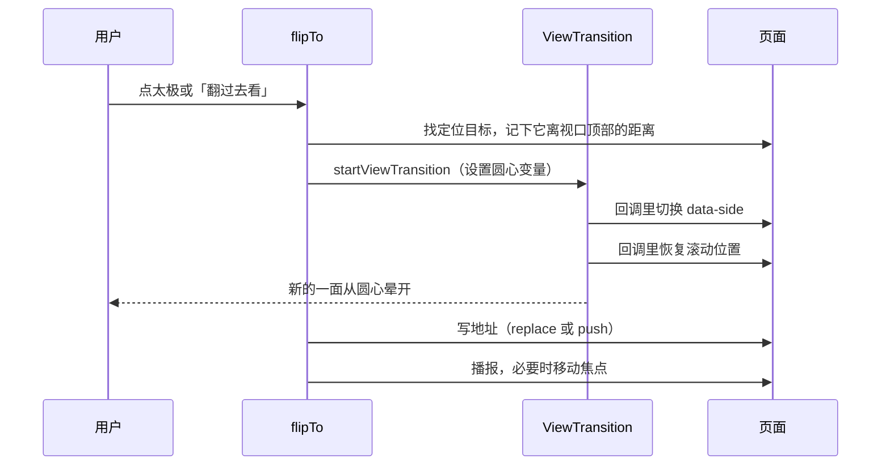

# 两仪 · 设计文档

版本：v1.1 设计稿，2026-10-14
范围：在第一版（单页时间线、明暗切换、厂商筛选、梗图、`pnpm draft`）的基础上，把「明暗对照」做成产品的核心体验。
读者：之后实施的人。每一节末尾都有可验收的标准。

---

## 0. 一句话定位

**中文世界有出处的大模型翻车史，配上同一时期的发布作对照。**

- 暗史是内容重心，明史是背景和入口。
- 梗图负责传播，来源负责可信。娱乐做入口，可信做护城河。
- 不和 AI Incident Database、AIAAIC 比收录量和严谨度。能站住的差异是三点：中文、明暗对照、梗。

### 0.1 由定位推出的收录规则

这些规则在设计上会影响字段和显示，先定下来：

| 情况 | 处理 |
|---|---|
| 用户误用模型造成的事（律师用 ChatGPT 编判例、员工把代码贴进 ChatGPT） | 可以收，但必须在 `category` 里加 `误用`，严重程度最多 3，卡片上显示「误用」标签 |
| 厂商主动披露的测试结果（系统卡里的红队实验） | 可以收，`category` 加 `自披露`，严重程度最多 2，卡片上显示「厂商自披露」 |
| 平台方的问题（GitHub 误标某个组织） | 不收进暗史 |
| 人事八卦、梗图、纯舆论 | 不进编年主轴。可进乐子候选（标签 `候选/乐子`），核实前不上时间线 |
| `response` 字段 | 只写厂商、监管方或法院做了什么。编者评论不进这个字段 |

### 0.2 严重程度标尺

沿用 `CONTRIBUTING.md` 的定义，并要求严格执行：

| 等级 | 含义 | 例子 |
|---|---|---|
| 1 | 公开争议，没有明确事故 | GPT-2 暂不公开完整模型 |
| 2 | 小范围的错误或尴尬，厂商自披露的测试 | Claude Opus 4 系统卡的勒索实验 |
| 3 | 明确的产品事故，或用户误用造成的后果 | R1 自称 ChatGPT；三星员工泄露代码 |
| 4 | 大范围事故，伴随回滚、下线或股价、商誉上的明显损失 | Bard 发布广告答错；Gemini 生图暂停 |
| 5 | 隐私暴露、人身相关伤害，或被监管紧急限制 | ChatGPT 3 月 20 日故障；意大利限制 ChatGPT 和 DeepSeek |

---

## 1. 核心比喻：阳中有阴，阴中有阳

太极图里白鱼有一只黑眼，黑鱼有一只白眼。页面完全照这个来：

- **明史视图**：明史条目是完整卡片。暗史条目缩成时间轴上的**暗点**，就是阳中之阴。
- **暗史视图**：暗史条目是完整卡片。明史条目缩成时间轴上的**亮点**，就是阴中之阳。
- **点太极**：主次对调，氛围随之整体切换。
- **靠近一个点**：先露出一张小纸条（窥视），想看全貌再翻过去。

另一面的条目始终在时间轴上，从来不会消失。用户要主动靠近，才能看到它是什么。

---

## 2. 信息结构

一个页面，一根时间轴，从新到旧往下排：

```text
页头（两仪 · 一句说明 · 太极）
厂商筛选
统计行
时间轴
  2026
    节点（卡片或点）
    ...
  2025
    ...
页脚（投稿 · 说明）
悬浮太极（页头滚出视口后出现）
```

### 2.1 排序

- 按日期从新到旧排。
- 同一天的两条，暗史排在明史上面。从新到旧读的话，「事后」本来就排在「发布」前面。
- **不按真实时间比例留间距。** 每个节点占一行。用年份分组，并在年份内显示月份刻度。

### 2.2 节点

每个事件渲染成一个**节点**。节点内部永远包含三样东西，由 CSS 决定当前显示哪一样：

| 部件 | 作用 | 何时可见 |
|---|---|---|
| 点（pip） | 标记「这里有一条另一面的事」 | 节点属于另一面时 |
| 窥视（peek） | 小纸条，显示标题和关联信息 | 点被悬停、聚焦或点击后 |
| 卡片（card） | 完整内容 | 节点属于当前这一面时 |

两面的卡片都在构建时完整输出到 HTML 里，不靠 JavaScript 请求。这样搜索引擎能收录，没有 JavaScript 时也能阅读（见 8.3）。

---

## 3. 布局

### 3.1 桌面端（宽度 ≥ 760px）

三栏网格：左栏放明史，中间是轴，右栏放暗史。

```text
            明史视图                                   暗史视图

 ┌────────────────────┐                                       │
 │ 2024.05.13         │                                       ○  2024.05.13
 │ GPT-4o 发布         │──●                                    │
 │ 之后：2 次翻车 ›     │   │                    ┌──────────────────────┐
 └────────────────────┘   ◆ 05.20               │ 2024.05.20           │
                          │                   ●──│ Sky 声音被指接近…     │
                          │                     │ GPT-4o 发布后第 7 天   │
                                                └──────────────────────┘

  ● 当前这一面卡片的连接点     ◆ 暗点（大小 = 严重程度）     ○ 亮点
```

- 网格列：`minmax(0, 1fr) var(--spine) minmax(0, 1fr)`，`--spine` 取 `3rem`。
- 明史节点放第 1 列，暗史节点放第 3 列。点永远落在第 2 列的中线上。
- 收起的节点只占一行很矮的高度（约 `1.75rem`），里面只有点和一个很淡的日期。
- 页面最大宽度从现在的 `46rem` 加到 `64rem`，两栏才放得下。

### 3.2 手机端（宽度 < 760px）

单栏。时间轴贴在左边，距离左边缘 `1.25rem`。

- 当前这一面的卡片在轴的右侧。
- 另一面的点贴在轴上，右边跟一行很淡的小字：日期加标题前 12 个字。
- 窥视不浮在上面，而是**在点下方展开**，把后面的内容往下推。这样不会被屏幕边缘裁掉。

### 3.3 点的样式

| | 明史视图里的暗点 | 暗史视图里的亮点 |
|---|---|---|
| 形状 | 实心圆 | 空心圆环（线宽 1.5px） |
| 颜色 | `--ink` | `--card` 填充，`--muted` 描边 |
| 大小 | 由严重程度决定 | 固定 8px |

暗点的直径按严重程度：1 级 6px，2 级 8px，3 级 10px，4 级 13px，5 级 16px。

点击热区一律不小于 32×32px，用透明的外扩区域实现，不放大视觉上的点。

形状不同（实心或空心）是为了照顾色弱用户，不能只靠颜色区分明暗。

---

## 4. 交互

### 4.1 三层递进

1. **点**：只告诉你这里有东西，以及事情有多大。
2. **窥视**：显示日期、标题、严重程度、和对应发布的关系，以及一个「翻过去看」按钮。不显示摘要和来源。
3. **翻面**：整个页面切到另一面，并定位到这一条。

### 4.2 窥视的触发

| 设备 | 打开 | 关闭 |
|---|---|---|
| 桌面鼠标 | 悬停在点上 120ms 后打开 | 离开点和纸条 200ms 后关闭。留出时间让鼠标移到纸条上 |
| 键盘 | 点获得焦点时打开 | 失去焦点，或按 Esc |
| 触屏 | 点一下打开 | 再点一次点、点页面其他地方，或打开了另一个窥视 |

规则：

- 同一时间最多只开一个窥视。
- 不做「滚动到屏幕中间就自动显示」。条目一多，页面会一直闪。
- 窥视里的「翻过去看」是唯一能从窥视进入翻面的入口。

### 4.3 窥视的内容

```text
┌──────────────────────────────────┐
│ 2024.05.20 · OpenAI   ■■■□□      │
│ Sky 声音被指接近斯嘉丽·约翰逊       │
│ GPT-4o 发布后第 7 天               │
│                     翻过去看 →    │
└──────────────────────────────────┘
```

暗史视图里窥视明史条目时，第三行改成「之后：2 次翻车」，没有关联就不显示这一行。

### 4.4 卡片上的关联

- **明史卡片**有关联的暗史时，底部显示一行「之后：N 次翻车 ›」。点击后翻到暗史，定位到时间最早的那一条。
- **暗史卡片**有关联的明史时，日期旁显示「GPT-4o 发布后第 7 天」。点击后翻到明史，定位到那条发布。

### 4.5 天数的显示

由构建时按 UTC 日期计算，不手写。

| 相差 | 显示 |
|---|---|
| 0 天 | 发布当天 |
| 1 到 59 天 | 发布后第 N 天 |
| 60 天及以上 | 发布后约 N 个月（天数除以 30.4，四舍五入） |

### 4.6 厂商筛选

- 同时作用于卡片和点。
- 一个年份里只要有任何一面的节点符合筛选，这一年就显示。
- 两面都没有符合的节点时，显示空状态「这个厂商还没有条目」。
- 筛选改由 JavaScript 给节点和年份加 `hidden`。去掉 `VendorFilter.astro` 里按厂商生成 CSS 规则的做法，也就不存在把厂商名拼进 `<style>` 的注入问题。

---

## 5. 翻面

### 5.1 触发入口

| 入口 | 墨晕的圆心 | 定位目标 | 历史记录 |
|---|---|---|---|
| 页头太极 | 太极中心 | 切换前视口中间的那个节点 | `replaceState` |
| 悬浮太极 | 悬浮太极中心 | 同上 | `replaceState` |
| 窥视里的「翻过去看」 | 被窥视的那个点 | 被窥视的那一条 | `pushState` |
| 卡片上的关联链接 | 被点击的链接 | 关联的那一条 | `pushState` |

从窥视或关联链接翻面时用 `pushState`，这样按浏览器的返回键能回到原来那一面、原来的位置。此时 `popstate` 监听才真正有用。

### 5.2 动画：水墨从落点晕开

用同文档 View Transitions（`document.startViewTransition`）：

- 新的一面像一滴墨落在纸上，从落点向外晕开铺满视口。实现上是给 `::view-transition-new(root)` 加一张墨迹遮罩，再放大 `mask-size`，同时调整 `mask-position`，让墨迹中心一直停在落点。
- 墨迹在第一次翻面时用 canvas 画一次并缓存：中间是实心墨团，四周是不规则的晕边和细碎墨点。半径 30% 以内保证完全不透明。
- 速度不是匀速：墨滴落下的一瞬间迅速化开，越往外渗得越慢。时长 1200ms，前 90% 的时间按 `1 - (1 - t)^2.4` 从 0 放大到 90%，前 100ms 就铺开约六分之一，之后逐渐慢下来。最后 10% 再快速放大到「实心部分刚好盖住视口最远角」。这时晕边早已盖满屏幕，看不出加速，但能保证拆掉过渡层时边角不跳。曲线在 `flip.ts` 的 `inkSpread()` 里，用 32 个关键帧采样。
- 墨迹动画要用 `fill: "forwards"`，过渡结束后再 `cancel()`。不保持的话，动画结束到过渡层拆掉之间有一帧遮罩会退回 0，整页闪一下旧的一面。
- 翻面期间给 `<html>` 加 `is-flipping`，暂停云雾漂移和太极自转，减少重绘。
- 旧的一面不做动画，被新的一面盖住。
- 明转暗、暗转明用同一个动画，都是「新的一面从落点晕开」。
- 太极同步转半圈（180°），之后停在那个角度。明史 0°，暗史 180°。

第一版的整页 `rotateY` 翻转（`@keyframes turn` 和两个 `setTimeout`）已经去掉。

### 5.3 位置保持（必须做）

切换时卡片一展开、一收起，页面高度会大变。不处理的话，用户会被甩到别的年份，明暗对照就断了。

步骤：

1. 确定定位目标：入口给了目标就用它；否则在所有可见节点里，找垂直中点离视口中线最近的那个。
2. 记下它的 `getBoundingClientRect().top`。
3. 在 `startViewTransition` 的回调里切换 `data-side`，接着同步把滚动位置调到让目标节点的 `top` 回到第 2 步记下的值。
4. 如果目标来自窥视或关联链接，改为让目标卡片居中，并给它一个 1.2 秒的描边呼吸提示。

第 3 步必须放在回调里，View Transitions 截取新画面时滚动位置才是对的。

### 5.4 降级

| 情况 | 行为 |
|---|---|
| 浏览器不支持 View Transitions | 直接切换，位置保持照做 |
| 用户开启「减少动态效果」 | 直接切换，太极不转动画，位置保持照做 |
| 动画进行中再次点击 | 忽略，直到这次过渡结束 |

### 5.5 翻面之后

- 屏幕阅读器通过一个 `aria-live="polite"` 的区域播报「已切到暗史，20 条」。
- 从窥视或关联链接翻过来时，焦点移到目标卡片的标题上（标题加 `tabindex="-1"`）。

---

## 6. 氛围

颜色、质感、文案语气三样一起换，氛围就出来了。整体要克制，不上故障风全家桶。

### 6.1 设计变量

明史是「仙」：雾白、远山、宣纸。暗史是「幽」：墨黑、烟、噪点。变量都在 `global.css` 里。

| 变量 | 明史 | 暗史 | 说明 |
|---|---|---|---|
| `--bg` | `#e9ede7` 雾白 | `#0b100e` | 页面底色 |
| `--sky-top` | `#f5f4ef` | `#131b18` | 页头顶部的天色，往下 22rem 渐变到 `--bg` |
| `--card` | `#f8f7f2` | `#141a17` | 纸笺颜色。窥视用它的不透明版本 |
| `--card-alpha` | `58%` | `72%` | 卡片纸面的不透明度 |
| `--ink` | `#1f2a25` | `#e3ebe6` | |
| `--muted` | `#5a6a63` | `#9fb2a8` | |
| `--line` | `#c3cec7` | `#2a3731` | |
| `--accent` | `#a5322b` 朱砂 | `#c9a874` 旧铜 | 题记、干支、厂商印章、筛选选中点 |
| `--mtn` | `#2c3a34` | `#7f948a` | 远山颜色，三层山的不透明度另外写 |
| `--cloud` | 白 85% | 灰绿 10% | 云雾颜色 |
| `--grain` | `0.05` | `0.09` | 纸纹或噪点的不透明度 |
| `--spine` | `3rem` | `3rem` | 轴所在列的宽度 |
| `--spine-line` | 1.5px 淡墨实线 | 1px 虚线，3px 实 4px 空 | 两端渐隐。暗史的轴像裂痕 |

字体两面保持一致，否则切换时版面会跳：

| 变量 | 字体 | 用在 |
|---|---|---|
| `--display` | 宋体 | 「两仪」、年份、卡片标题 |
| `--kai` | 霞鹜文楷（`lxgw-wenkai-screen-webfont`，随站点自托管，按 Unicode 区段分块加载） | 题记、说明、摘要、「事后」、关联、页脚 |
| `--sans` | 系统无衬线 | 厂商名、模型名、来源链接 |
| `--mono` | 等宽 | 日期 |

### 6.4 质感

- 页头后面三层水墨远山和三团缓慢漂移的云，只占页头的 22rem，不进入时间轴。
- 整页叠一层宣纸纹（`body::after`），暗史改成 `screen` 混合，像噪点。
- 卡片是半透明纸笺，左边一道两端渐隐的淡墨线，不用投影。厂商标签是朱印。
- 太极是毛笔质感（SVG 位移滤镜），外加一道开口的墨圈，平时 90 秒自转一圈。图形放在页面里的 `<symbol id="taiji">`，两个太极按钮用 `<use>` 引用。
- 年份前加干支纪年，由 `ganzhi()` 计算。
- 题记是「易有太极 · 是生两仪」，交代名字的出处。

「减少动态效果」下，云雾漂移和太极自转都停掉。

### 6.2 文案

| 位置 | 明史 | 暗史 |
|---|---|---|
| 一句说明 | 同一条时间线，明史记发布与节点 | 同一条时间线，暗史记翻车与事后 |
| 统计行 | 明史 N 条 · 暗处 M 个点 | 暗史 M 条 · 明处 N 个点 |
| 卡片关联 | 之后：N 次翻车 | 某某发布后第 N 天 |
| 太极下方提示 | 翻到暗史 | 翻回明史 |

### 6.3 动效

| 动效 | 阶段 | 说明 |
|---|---|---|
| 墨晕切换 | 第二阶段 | 见 5.2 |
| 太极半圈旋转 | 第二阶段 | 见 5.2 |
| 4 级以上的暗史标题在首次进入视口时轻微错位 | 第三阶段 | 横向偏移 2px，红绿通道分离，150ms 一次，不循环 |
| 窥视出现 | 第一阶段 | 透明度和 4px 位移，120ms |

所有动效在「减少动态效果」下关闭。

---

## 7. 悬浮太极

- 页头的太极滚出视口后（用 `IntersectionObserver` 判断），在右下角出现一个直径 3rem 的悬浮太极。
- 行为和页头太极完全一致，角度也同步。
- 距离屏幕边缘：桌面 1.5rem，手机 1rem，避开 iOS 底部的安全区域（`env(safe-area-inset-bottom)`）。
- 页头太极回到视口时，悬浮太极淡出。

---

## 8. 可访问性与降级

### 8.1 语义

| 元素 | 写法 |
|---|---|
| 太极按钮 | `aria-label` 固定为「明暗切换」，用 `aria-pressed` 表示是否在暗史。不再同时改 `aria-label` |
| 点 | `<button aria-expanded aria-controls="peek-<id>">`，`aria-label` 写成「暗史：Sydney 对记者表达爱意，严重程度 5」 |
| 窥视 | 普通的展开区块（disclosure），不是 tooltip，因为里面有按钮 |
| 年份标题 | 保留 `<h2>`；卡片标题保留 `<h3>` |

### 8.2 键盘

- Tab 依次经过：筛选按钮、太极、每个节点（卡片里的链接或点）。
- 点获得焦点即打开窥视；Esc 关闭并把焦点留在点上。
- 窥视打开时，Tab 进入窥视里的「翻过去看」。

### 8.3 没有 JavaScript 时

- `<html>` 默认带 `no-js` 类，页头的内联脚本第一行就把它去掉。
- `no-js` 状态下两面的卡片全部展开，按 3.1 的两栏排列，不显示点，也不显示太极。
- 这样关闭脚本的读者、爬虫和阅读模式都能看到全部内容。

### 8.4 浏览器支持

- 依赖：CSS Grid、`color-mix()`、`:has()`（只用于少量装饰）。
- View Transitions 不支持时按 5.4 降级。

---

## 9. 地址与分享

### 9.1 地址格式

```text
/?side=dark&vendor=OpenAI#gpt-4o-sycophancy-2025
```

| 部分 | 含义 |
|---|---|
| `side` | `dark` 打开暗史，省略为明史 |
| `vendor` | 厂商筛选，必须是现有厂商之一，否则忽略 |
| `#id` | 定位到某一条，id 就是 YAML 的文件名 |

### 9.2 打开时的规则

1. 有 `#id`、没有 `side` 时，按这条事件所在的那一面打开。这样只转发事件链接也能直接看到它。
2. `#id` 对应的事件被当前厂商筛选挡住时，忽略筛选。
3. 打开后让这一条居中，给一次描边提示。

### 9.3 分享卡片（第二阶段）

- 页面加 `og:title`、`og:description`、`og:image`、`twitter:card`。
- 静态站对 `?side=dark` 只能给同一张预览图。如果想让暗史有单独的预览，新增 `/dark/` 页面，内容相同，默认暗史，单独一张 `og:image`。
- 卡片右上角加「复制链接」，复制 9.1 格式的地址。

---

## 10. 数据结构

### 10.1 新增字段

```ts
// src/content.config.ts，只列变化
schema: z
  .object({
    // ...已有字段
    related: z.string().optional(), // 暗史条目指向对应明史条目的 id
  })
  .superRefine((data, ctx) => {
    if (data.side === "dark" && data.severity === undefined) {
      ctx.addIssue({ code: "custom", path: ["severity"], message: "暗史必须填严重程度" });
    }
    if (data.side === "light" && data.severity !== undefined) {
      ctx.addIssue({ code: "custom", path: ["severity"], message: "明史不填严重程度" });
    }
    if (data.side === "light" && data.related !== undefined) {
      ctx.addIssue({ code: "custom", path: ["related"], message: "只有暗史填 related" });
    }
    if (data.category.includes("误用") && (data.severity ?? 0) > 3) {
      ctx.addIssue({ code: "custom", path: ["severity"], message: "误用类最多 3 级" });
    }
    if (data.category.includes("自披露") && (data.severity ?? 0) > 2) {
      ctx.addIssue({ code: "custom", path: ["severity"], message: "自披露类最多 2 级" });
    }
  }),
```

只允许暗史指向明史，关系方向单一，数据不会互相矛盾。明史卡片上的「之后：N 次翻车」由构建时反查得出。

### 10.2 构建时的校验

在 `src/lib/events.ts` 里加载数据时检查，不通过就抛错，让构建失败：

| 检查 | 失败时 |
|---|---|
| `related` 指向的 id 存在 | 构建失败 |
| 指向的条目是明史 | 构建失败 |
| 暗史日期不早于明史日期 | 构建失败 |
| 两者厂商相同 | 只打印警告，允许跨厂商（例如必应用的是 OpenAI 模型） |
| 梗图文件在 `public/memes/<id>/` 下存在 | 构建失败 |

被指向的明史条目还是 `verified: false` 时，不报错，页面上当作没有关联。

### 10.3 构建时派生的数据

```ts
type TimelineNode = {
  entry: EventEntry;
  // 暗史才有
  parent?: { id: string; model: string; days: number };
  // 明史才有，按日期从早到晚
  fallout: { id: string; title: string; days: number; severity: number }[];
};
```

页面只读 `TimelineNode`，不在组件里自己算关联。

### 10.4 现有数据的关联

天数由构建计算，这里只列关联关系。

| 暗史 | `related` | 备注 |
|---|---|---|
| `bing-sydney-2023` | `bing-chat-2023` | 第 9 天 |
| `sky-voice-2024` | `gpt-4o-2024` | 第 7 天 |
| `gpt-4o-sycophancy-2025` | `gpt-4o-2024` | 约 12 个月 |
| `deepseek-censor-2025` | `deepseek-r1-2025` | 第 8 天 |
| `deepseek-identity-2025` | `deepseek-r1-2025` | 第 10 天 |
| `deepseek-italy-2025` | `deepseek-r1-2025` | 第 10 天 |
| `claude-blackmail-2025` | `claude-4-2025` | 发布当天，按 0.1 改为「自披露」，严重程度降到 2 |
| `chatgpt-outage-2023` | `chatgpt-2022` | |
| `chatgpt-italy-2023` | `chatgpt-2022` | |
| `samsung-chatgpt-2023` | `chatgpt-2022` | 按 0.1 加「误用」 |
| `avianca-chatgpt-2023` | `chatgpt-2022` | 按 0.1 加「误用」，严重程度降到 3 |
| `gemini-images-2024` | `gemini-2023` | 待定：生图功能和 Gemini 1.0 发布是否算同一次发布 |
| `nyt-lawsuit-2023` | 待定 | 诉讼针对训练数据，不对应某一次发布 |
| `qwen-github-2024` | 无 | 按 0.1 不再收进暗史 |

### 10.5 建议补的明史条目

下面这些暗史目前没有对应的发布，补上之后明暗对照才完整。日期在入库时按原始来源再核对一遍。

| 补充的明史 | 大致日期 | 对应的暗史 |
|---|---|---|
| Bard 发布 | 2023-02-06 | `bard-jwst-2023` |
| LLaMA 发布 | 2023-02-24 | `llama-leak-2023` |
| Galactica 演示上线 | 2022-11-15 | `galactica-2022` |
| AI Overviews 推出 | 2024-05-14 | `ai-overviews-2024` |
| Tay 上线 | 2016-03-23 | `tay-2016`（同一天，显示「发布当天」） |

---

## 11. 代码改动地图

| 文件 | 改动 |
|---|---|
| `src/content.config.ts` | 加 `related` 和 10.1 的校验 |
| `src/lib/events.ts` | 新增 `buildTimeline()`：过滤已核实、排序（2.1）、构建 `TimelineNode`、执行 10.2 的检查、计算天数文案（4.5） |
| `src/components/Timeline.astro` | 改为渲染节点。每个节点同时输出点、窥视、卡片 |
| `src/components/TimelineNode.astro` | 新建。包住 `EventCard`，加上点和窥视 |
| `src/components/EventCard.astro` | 加关联行（4.4），图片加 `loading="lazy"` 和 `decoding="async"`，显示「误用」「厂商自披露」标签 |
| `src/components/SideToggle.astro` | 修正 `aria-label`（8.1）；加一个 `floating` 属性用于悬浮太极 |
| `src/components/VendorFilter.astro` | 去掉生成的 `<style>` |
| `src/pages/index.astro` | `no-js` 类；内联脚本处理 9.2 的规则；加 `aria-live` 区域；第二阶段加分享元信息 |
| `src/scripts/chronicle.ts` | 拆成下面几个模块 |
| `src/styles/global.css` | 新变量（6.1）、两栏网格（3.1）、手机单栏（3.2）、点（3.3）、窥视、View Transitions 样式、`no-js` 样式。删掉 `@keyframes turn` |

`chronicle.ts` 拆成：

| 模块 | 职责 |
|---|---|
| `state.ts` | 从地址读取和写入 `side`、`vendor`、`#id`。地址是唯一的状态来源 |
| `flip.ts` | `flipTo(side, { origin, targetId, push })`：定位目标、墨晕、位置保持、焦点和播报 |
| `peek.ts` | 窥视的打开、关闭、互斥，以及悬停延时 |
| `filter.ts` | 厂商筛选，给节点和年份加 `hidden`，处理空状态 |
| `floating.ts` | 悬浮太极的出现和消失 |

### 11.1 翻面的时序



---

## 12. 分阶段实施

按剃刀原则排序。每个阶段单独可以上线。

### 第零阶段：上线前提（内容）

设计再好，数据不可信也没用。这些先做：

- [ ] 40 条种子全部改回 `verified: false`，人工逐条核对后再改回来
- [ ] 删掉按日期拼出来的存档链接，换成真实存在的快照
- [ ] 修正 `claude-2023` 的标题（2023 年 3 月是对企业开放申请，不是对公众开放）和 `galactica-2022` 的错字「打开放」
- [ ] 按 0.2 重打严重程度，按 0.1 处理误用、自披露和平台类条目
- [ ] `deepseek-censor-2025` 的 `response` 改成只写事实
- [ ] 补勘误和申诉的 Issue 模板、免责声明、`LICENSE`

### 第一阶段：明暗对照成立

- [ ] 数据：`related` 字段、10.1 和 10.2 的校验、10.4 的关联
- [ ] 节点结构：点、窥视、卡片
- [ ] 桌面两栏、手机单栏
- [ ] 窥视的三种触发方式
- [ ] 卡片上的关联行和天数
- [ ] 翻面时保持位置（先不做墨晕，直接切换）
- [ ] 厂商筛选改用 JavaScript
- [ ] `no-js` 降级

**验收**

- 明史视图里，每条已核实的暗史都显示为一个暗点，点的大小和严重程度一致
- 桌面悬停、键盘聚焦、手机点击都能打开窥视，同一时间只开一个
- 在 2024 年中间点太极，切换后视口里仍然是 2024 年 5 月附近的内容
- 从 Sky 的窥视点「翻过去看」，切到暗史且 Sky 的卡片居中；按返回键回到明史，GPT-4o 附近
- GPT-4o 明史卡片显示「之后：2 次翻车」
- 把某条 `related` 写成不存在的 id，构建失败
- 关闭 JavaScript 后，两面所有已核实条目的卡片都能看到

### 第二阶段：氛围与传播

- [ ] 墨晕切换和太极旋转
- [ ] 悬浮太极
- [ ] 9.2 的打开规则
- [ ] 分享元信息和「复制链接」
- [ ] 可选：`/dark/` 页面和单独的预览图

**验收**

- 墨晕从点击的位置开始，1 秒内铺满视口，结尾没有停顿
- 开启「减少动态效果」后没有任何过渡，位置保持仍然正常
- 只转发 `/#gpt-4o-sycophancy-2025`，打开后直接是暗史且这一条居中
- 把链接贴进微信或 Twitter 能显示预览卡片

### 第三阶段：质感（可选）

- [x] 纸纹和噪点、远山云雾、毛笔太极、干支纪年（见 6.4）
- [ ] 4 级以上暗史标题的轻微错位
- [ ] 连接一对明暗节点的 S 形曲线，只在悬停时显示一条，避免条目多了满屏是线

---

## 13. 待决定的问题

这些不影响第一阶段开工，但要在第二阶段之前定下来：

1. **部署地点。** `pages.dev` 和 Vercel 在大陆访问不稳定，目标读者却在国内。是继续用海外托管，还是另找国内能稳定访问的方案？
2. **收录范围。** 国产模型（豆包、文心、Kimi、智谱等）要不要收、收到什么程度？涉及审查的条目在国内平台上传播受限，这一点会反过来影响收录。
3. **梗图投稿门槛。** GitHub Issue 只适合开发者。要不要给普通网友一个更低门槛的入口，比如表单或邮箱？
4. **`gemini-images-2024` 和 `nyt-lawsuit-2023` 的关联。** 见 10.4。

---

## 14. 交互原型与设计稿

`docs/prototype/index.html` 是第一、二阶段关键效果的可运行原型。它是单个文件，没有外部依赖，用浏览器直接打开即可。原型里的数据是示意，已经按 0.1 和 0.2 调过严重程度，但没有核实过来源。

正式实现时，原型里「构建期」那部分搬进 `src/lib/events.ts`，「渲染」部分改写成 Astro 组件，「运行期」部分按第 11 节拆进 `src/scripts/`。

### 14.1 设计稿

`docs/prototype/shots/` 下的截图都是在原型里真实操作后截的：

| 文件 | 状态 |
|---|---|
| `01-desktop-light.png` | 桌面明史首屏 |
| `02-desktop-peek.png` | 明史里窥视 Sky：纸条用暗史配色，像从缝里看到另一面 |
| `03-desktop-ink.png` | 从 Sky 的点翻面，墨晕进行到 40% 的一帧 |
| `04-desktop-dark-target.png` | 翻面完成：Sky 卡片停在原来那个点的位置，带一圈提示 |
| `05-desktop-dark-peek-light.png` | 暗史里窥视 GPT-4o 发布：纸条用明史配色，显示「之后：2 次翻车」 |
| `06-mobile-light-peek.png` | 手机明史，Sydney 的窥视在点下方展开 |
| `07-mobile-dark-hash.png` | 手机打开 `?side=dark#deepseek-censor-2025`，直接定位并居中 |

### 14.2 关键效果在原型里的位置

| 效果 | 对应章节 | 原型里的位置 |
|---|---|---|
| 关联与天数 | 4.5、10.3 | 「构建期逻辑」一段和 `relText()` |
| 节点结构（点、窥视、卡片） | 2.2 | `nodeHtml()` |
| 两栏与单栏布局 | 3.1、3.2 | `.node` 网格规则和 `@media (max-width: 759px)` |
| 点的大小和形状 | 3.3 | `.pip` 和 `PIP_SIZE` |
| 窥视用另一面的配色 | 4.3 | 样式开头「窥视用的是另一面的配色」一段 |
| 窥视的触发与互斥 | 4.2 | `openPeek()`、`closePeek()` 和紧接着的事件绑定 |
| 墨晕翻面与位置保持 | 5.2、5.3 | `flipTo()`、`nearestCenterNode()`、`::view-transition-old` 规则 |
| 返回键恢复位置 | 5.1 | `flipTo()` 里的 `replaceState` 和 `popstate` 监听 |
| 悬浮太极 | 7 | `IntersectionObserver` 一段 |
| 打开时的地址规则 | 9.2 | 「打开时：9.2 的规则」一段 |
| 厂商筛选 | 4.6 | `applyFilter()` |

调试参数只用于截图：`?peek=<id>` 打开某个窥视，`?ink=0.45` 把墨晕冻结在 45%。正式实现不要带。

### 14.3 已在原型里验证的验收项

用 Chrome 无头模式在原型里实际操作并测量：

| 验收项 | 结果 |
|---|---|
| 在 2024 年中间点太极，视口中间那一条的位置不变 | 切换前后都在离视口顶部 506px 处 |
| 从 Sky 的窥视翻到暗史 | 进入暗史，地址变为 `?side=dark#sky-voice-2024`，卡片居中，焦点移到标题 |
| 接着按返回键 | 回到明史，地址恢复，Sky 的点回到原来的 484px |
| 只带 `#gpt-4o-sycophancy-2025` 打开 | 自动进入暗史并居中 |
| 筛选 Meta | 统计为「明史 1 条 · 暗处 1 个点」，只剩两个年份 |

### 14.4 实施时容易踩的坑

1. **绝对定位的网格子元素要写全起止线。** 窥视是 `position: absolute` 的网格子元素。只写 `grid-column: 1` 时，结束线 `auto` 会被当成容器的边缘，窥视会跑到另一栏。要写成 `grid-column: 1 / 2`。原型里一开始就踩了这个坑。
2. **墨晕要用脚本做动画，不要只写 CSS。** 先用 CSS 关掉 `::view-transition-old(root)` 和 `::view-transition-new(root)` 默认的交叉淡入，再在 `transition.ready` 之后对 `::view-transition-new(root)` 调用 `element.animate()`。原型里动画的是 `clip-path`，正式站点改成墨迹遮罩的 `mask-size` 和 `mask-position`（见 5.2）。这样落点和大小可以按每次点击的位置算。
3. **滚动必须在 `startViewTransition` 的回调里完成。** 放在回调外面，截下来的新画面是没滚动过的，动画结束时会跳一下。
4. **设置 `history.scrollRestoration = "manual"`。** 否则按返回键时，浏览器会按旧的页面高度恢复滚动，和自己的恢复逻辑打架。
5. **新画面是活的。** 墨晕期间新画面仍在实时渲染，所以太极的旋转过渡会正常播放，不需要额外处理。
6. **窥视里有按钮，就不能当 tooltip。** 用按钮加 `aria-expanded` 的展开模式，Esc 关闭后把焦点还给点，并且这次聚焦不能再把窥视打开。
